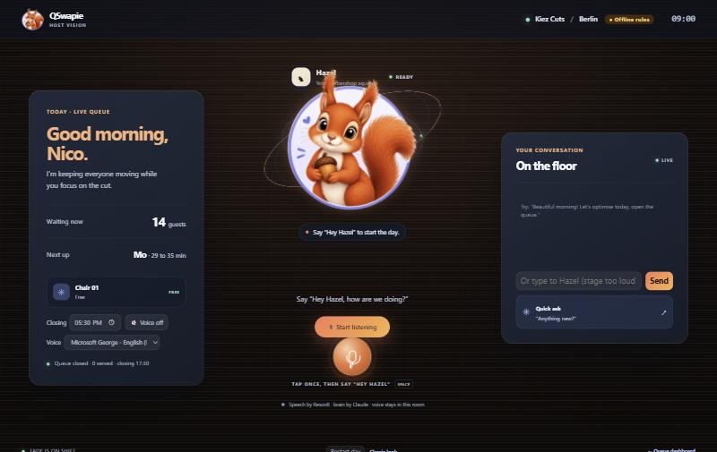
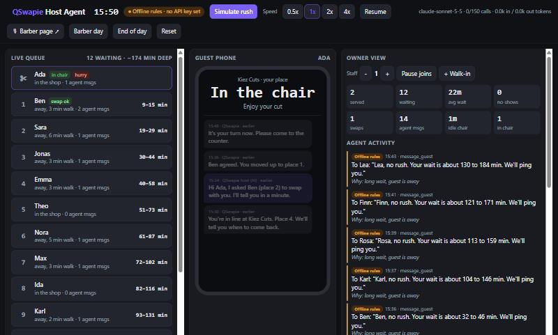

# QSwapie Host Agent

**A proactive AI host for walk-in venues, with a hands-free voice sidekick for the barber.**

Walk-in waiting is dead time: guests stand around or walk away, and chairs sit idle when the next guest isn't there. QSwapie Host Agent runs the queue for the venue *on its own*. A Claude agent watches the live line, gives every guest an honest wait range, tells people when to come back, flags no-shows, arranges swaps for guests in a hurry and warns the owner before things go wrong. At the chair, the barber talks to **Hazel**, a barbershop squirrel sidekick built on **Reson8** live speech-to-text and **Claude**. After "Hey Hazel", she greets the barber with the day's numbers, takes the go-ahead, reports every cancellation, rebooking and swap in one spoken line, and answers "how are we doing?", all hands-free.

Built at **Agentic AI Hack by Jamie** ({Tech: Europe}, Berlin, 2026-10-24), Open Agentic Track. Partner tech: **Anthropic** (Claude Sonnet 5.5 for the queue agent, Claude Haiku 5.5 for fast voice, tool use) and **Reson8** (Turns speech-to-text).

| Barber voice page (`/barber`) | Queue agent page (`/`) |
|---|---|
|  |  |

*Screenshots in offline mode (no API keys), same live simulation on both pages. The stage look is the default; add `?skin=old` to either URL for the classic look.*

## What it does

**Page 1: the queue agent** (`http://localhost:5173/`)
1. Predicts each guest's wait as an **honest range** (e.g. 12 to 20 min), not a fake single number.
2. **Messages guests proactively**: "no rush, about 35 to 50 min" or "head back now", timed to each guest's walk-back distance.
3. **Flags no-shows** and moves the line up.
4. **Hurry swaps**: when a guest taps "I'm in a hurry", it finds a guest ahead who is happy to swap and proposes it to both.
5. **Alerts the owner**: "queue is 50 min deep, pause new joins?", "2 no-shows in 30 min", plus an end-of-day summary.
6. Every action appears in the **agent activity feed** with a one-line reason and a badge: *Claude* or *Offline rules*.

**Page 2: the barber voice page** (`http://localhost:5173/barber`)
- Big orb mic, live transcript, natural voice output, mute, voice picker, closing time, typed fallback.
- **Wake word "Hey Hazel"**: the mic listens hands-free; on the first wake word Hazel greets the barber (Nico) with today's numbers and waits for the go-ahead.
- Voice commands with tools: open or close the queue, today's summary, finish time, capacity check ("2 more?"), recent events.
- **Between cuts**, Hazel proactively reports news: "Nico, heads up: Lina walked away, Ben swapped with Ada."

Both pages run on the **same live simulation**, so they can sit side by side on stage.

## Quick start

Requires **Node.js 24+** (TypeScript runs directly through Node's type stripping, so there is no build step).

**Windows (PowerShell)**: both keys are typed hidden and live only in this window.
```powershell
npm install
$a = Read-Host 'Anthropic key' -AsSecureString; $r = Read-Host 'Reson8 key' -AsSecureString; $env:ANTHROPIC_API_KEY = [Net.NetworkCredential]::new('', $a).Password; $env:RESON8_API_KEY = [Net.NetworkCredential]::new('', $r).Password; npm start
```

**macOS / Linux (bash)**
```bash
npm install
read -rs -p "Anthropic key: " ANTHROPIC_API_KEY; echo; read -rs -p "Reson8 key: " RESON8_API_KEY; echo; export ANTHROPIC_API_KEY RESON8_API_KEY; npm start
```

Or copy `.env.example` to `.env` (gitignored) and fill it in, then run `npm start`.

Open **two browser windows side by side**, ideally in **Microsoft Edge** (its "Natural" neural voices sound human; Chrome works too):
- left: http://localhost:5173/ (queue agent)
- right: http://localhost:5173/barber (barber voice)

No keys? It still runs: see [Fallbacks](#fallbacks).

### Environment variables

| Variable | Default | Purpose |
|---|---|---|
| `ANTHROPIC_API_KEY` | none | Claude for the queue agent and Hazel. Without it: offline rules |
| `RESON8_API_KEY` | none | Reson8 live speech-to-text. Without it: browser speech recognition |
| `BARBER_NAME` | `Nico` | The barber's name in the voice page and Hazel's lines |
| `CLOSE_TIME` | `19:00` (17:30 on the morning shift) | Shop closing time for the capacity checks (also editable on the page) |
| `PORT` | `5173` | HTTP port |
| `AGENT_MAX_CALLS` | `150` | Hard cap on Claude calls per server run |
| `WAKE_WORDS` | `hey hazel,hazel,hey hasel,hey hazle,hey q,hey queue,hey cue,hey kyu` | Comma-separated wake words for the barber page |

Keys are read only by the server and never sent to the browser or written to logs.

## 2-minute demo script: the morning shift

The story is scripted and the same on every run. Put `/` (queue) and `/barber` (Hazel) side by side.

**Part 1: Nico and Hazel (about 90 s), on `/barber`**
1. Click **Restart day** if needed: 09:00, one barber (Nico), 15 clients booked at about 30 to 45 minutes each, closed to walk-ins. The clock is paused.
2. Tap **🎙 Start listening** once (browsers need one tap for the mic). From now on the mic listens hands-free.
3. Say: *"Hey Hazel!"* Hazel greets proactively: *"Hey Nico! Today's gonna be packed: you've got 15 clients, about 30 to 45 minutes each, so you'll be done around five o'clock. Want me to open the queue for a couple more, say two extra?"*
4. Say: *"No, 15 is enough till five. Let me know if someone cancels, swaps or wants to withdraw; contact them, ask why, offer to reschedule for another day, and open the spot for someone else."* Hazel confirms in one line, keeps the queue closed, and the clock starts (1 sim minute per second).
5. Watch the queue page while Hazel reports each event in one spoken line:
   - **10:30 Lina cancels.** On her phone the agent asks why and offers a new day; she answers "work came up", takes tomorrow 10:00, and **Max** from the waitlist gets her slot. Hazel: *"Heads up Nico: Lina cancelled, work came up, rebooked for tomorrow 10:00, and Max took the slot."*
   - **About 11:05 Ada is in a hurry.** The guest agent asks Ben, who said he is happy to swap, and Ada goes first.
   - **12:00 Omar withdraws.** Same flow: reason, rebooked for Thursday 14:00, and **Zoe** takes the slot.
6. Anytime: *"Hey Hazel, how are we doing?"* gives a short status with the finish time. The small number under the mic is the time to Hazel's first spoken word.

The clock pauses while Nico and Hazel talk, so the story never runs away mid-sentence.

**Part 2: the queue agent (about 30 s), on `/`**
1. Point at the activity feed: every action has a *Why* and a *Claude* badge.
2. Click Lina's card to see the whole cancel and rebook conversation on her phone.
3. For the busy two-barber day, click **Reset** and then **Simulate rush**: head-back timing, no-shows, a hurry swap and the owner alert "pause new joins?". **End of day** writes a summary.

Speed buttons (0.5x to 4x) control sim minutes per real second. Add `?voice=off` to the barber URL to keep Hazel silent, or `?skin=old` for the classic look. On the barber page, Space toggles the mic, and the typed box works without a wake word.

## How it works

```
browser /barber ──mic PCM──▶ Node /stt ──▶ Reson8 Turns (WebSocket)
                ◀─turn events─┘
        └─ final text ─▶ POST /api/action ─▶ Claude (voice tools) ─▶ reply ─▶ speechSynthesis

simulation (engine.ts) ──signals──▶ agent loop (agent.ts) ──tool calls──▶ simulation
          └──────────── GET /api/state (both pages, ~2x per second) ────────────┘
```

- **Proactive loop**: the simulation raises signals (joins, hurry taps, late guests, guests near the front, deep backlog, no-shows). At most every 5 s, and only if something changed, the agent sends Claude a compact JSON snapshot with six tools (`get_queue`, `predict_wait`, `message_guest`, `propose_swap`, `mark_no_show`, `alert_owner`). Every action tool requires a `reason`.
- **Voice**: the browser streams 16 kHz mono PCM over a WebSocket to the server, which proxies it to Reson8 Turns with the key added server-side. On `turn_end`, the transcript is checked for the wake word; the command goes to Claude Haiku (streamed, compact state in the prompt), with six voice tools available (`day_summary`, `estimate_finish`, `capacity_check`, `open_queue`, `close_queue`, `recent_events`). The short reply (at most 2 sentences) is spoken sentence by sentence; the mic pauses while Hazel talks.
- **Guards**: the engine validates every action (no double messages, no early no-shows, no duplicate alerts). The hidden truth of the simulation (who will no-show, real cut lengths) is never shown to the agent.

Full details: [docs/ARCHITECTURE.md](docs/ARCHITECTURE.md) (diagrams, triggers, fallbacks, cost guards, key security) and [docs/APIS-AND-TOOLS.md](docs/APIS-AND-TOOLS.md) (every API, tool schema, framework and dependency).

### Fallbacks

The demo never dies on stage:
- **Claude** down, slow or without a key: offline rules take over (orange label) and Claude is retried after 15 s. Labels show the real cause: `timeout`, `network`, or `API 4xx: message`.
- **Reson8** missing or failing: the browser Web Speech API takes over. No mic at all: the typed box.
- **Text to speech**: browser `speechSynthesis`, preferring Natural neural voices.

### Cost guards

Queue agent: `claude-sonnet-5-5`, effort `low`, `max_tokens` 1200. Voice: `claude-haiku-5-5`, thinking off, `max_tokens` 150, streamed, with a compact state in the prompt so most replies need no tool round-trip; at most one agent run per 5 s and only on change; at most 2 requests per run and 4 per voice turn; `AGENT_MAX_CALLS` cap; 30 s timeout with 1 retry. The call counter and tokens are shown on screen, and every call's duration is logged on the server console.

## Tech stack

Node.js 24 (`http`, `fs`, built-in TypeScript type stripping, `process.loadEnvFile`), TypeScript, `@anthropic-ai/sdk`, `ws`, plain HTML/CSS/JS (no framework), browser Web Speech API. The stage skin (`public/skin/`: orb, mascot "Swapie", restyle) was designed with OpenAI Codex during the hackathon and wired into the live app here; `warm.css` adds the warm accent. External services: Anthropic Messages API, Reson8 Turns. No database and no deploy: everything runs locally.

## Project layout

```
src/engine.ts   queue simulation (seeded), wait ranges, events, barber scenario, capacity math
src/agent.ts    Claude agent loop + tools, voice agent (Hazel), offline rules, failure handling
src/server.ts   HTTP server, /api/state, /api/action, /stt WebSocket proxy to Reson8, page routes
public/index.html   queue page (/ and /guests)
public/barber.html  barber voice page (/barber)
public/voice.js     mic capture, Reson8 / Web Speech, speech output, voice picker
public/skin/        stage skin: barber page with the Hazel orb (squirrel.css), agent-ui.css, warm.css (default look)
public/img/         Hazel artwork (WebP, full size for the orb, 128 px for the mascot)
docs/               architecture and API documentation
pitch/              pitch and submission outlines
```

## Built today vs existed before

- **Existed before**: QSwapie, the founder's digital queue product for walk-in venues (QR code, live place, wait anywhere, trade places). Its code lives in a separate repository and was **not** changed or connected.
- **Built at the hackathon on 2026-10-24**: everything in this repository: the proactive queue agent and its tools, the barber voice agent (Reson8 proxy, voice tools, persona, speech output), the offline fallbacks, the queue simulation and demo data, both web pages, the stage skin (designed with Codex), the docs and the pitch outlines.
- All guests are **simulated** with fake first names. No real people, no real venue data, no payments.

## Credits

- **Hazel artwork** created by Karmel Salah with ChatGPT (`public/img/hazel*.webp`). If the image fails to load, an original SVG squirrel drawn for this project is shown instead.
- Stage skin (`public/skin/`) designed with OpenAI Codex during the hackathon.

## License

MIT, see [LICENSE](LICENSE).
