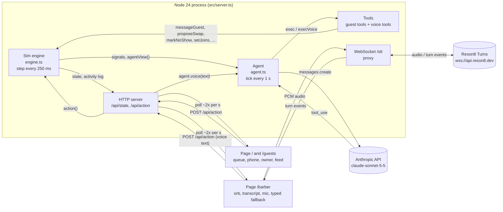
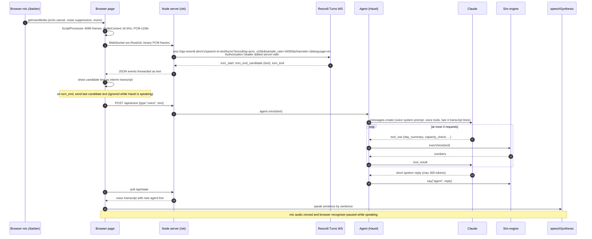

# Architecture

QSwapie Host Agent is a proactive AI host for a walk-in venue (a simulated barbershop, "Kiez Cuts"). One Node process runs a queue simulation, an agent that watches it, and a small HTTP/WebSocket server. Two browser pages show the same live simulation. There is no build step: Node 24 runs the TypeScript files directly (type stripping).

All guests are simulated with fake names. Nothing calls a QSwapie system. The only outbound calls are to the Anthropic API and (for speech-to-text) Reson8.

## Components

| Part | File | Role |
|---|---|---|
| Simulation engine | `src/engine.ts` | Seeded queue simulation, wait prediction, guest actions, event log, signals for the agent |
| Agent | `src/agent.ts` | Claude tool-use loop, offline rule fallback, voice agent "Hazel", budget and failure handling |
| Server | `src/server.ts` | HTTP (`/api/state`, `/api/action`, static files), WebSocket proxy `/stt`, timers |
| Pages | `public/` | `/` (and `/guests`): queue, guest phone, owner view, agent activity feed. `/barber`: full-screen barber voice page |

The two pages share one server and one simulation. Both poll `GET /api/state` about twice a second (the current code polls every 600 ms) and send every action with `POST /api/action`.

The barber is named by `BARBER_NAME` (default "Nico"). The voice agent is called "Hazel". When the barber taps "Start day" on `/barber`, Hazel greets him proactively with numbers it fetched from tools, and keeps reporting events between cuts.

## System diagram



## Runtime loop

- `setInterval(sim.step, 250 ms)`: advances simulated time by `speed * 0.25` sim minutes (1x = one sim minute per real second, range 0.25x to 8x). Joins, called guests arriving, services ending, swaps resolving, and the scripted barber day all happen here.
- `setInterval(agent.tick, 1000 ms)`: the proactive part. The agent runs a watchdog, collects new signals from the simulation, and acts on them (Claude if available, offline rules otherwise).
- Request handlers: `GET /api/state` returns one JSON snapshot. `POST /api/action` mutates the simulation. `voice` actions call `agent.voice(text)` and wait for the reply.

## Simulation model (`src/engine.ts`)

- Seeded RNG (mulberry32-style, seed 42): the same day replays identically after Reset.
- Each guest has a name, `away` flag (waiting somewhere else, 80 percent likely), `walk` minutes back (2 to 8), `swapOk` (35 percent), `hurry`, and a service time (mean 12 min, range 8 to 15).
- Hidden fields the agent never sees: `willNoShow` and `service`. `agentView()` builds the compact JSON for the model and leaves them out. A called guest with `willNoShow` simply never arrives.
- Wait prediction: guests are assigned to the next free chair (serving guests count their remaining time, called guests count walk plus a mean cut). The range is `[chair_time - 1.5k, chair_time + 2 + 2.5k]` minutes, where `k` is how many guests that chair already has queued. The range widens the further back a guest is. It is never a single number.
- Engine guards: no duplicate `kind` messages per guest (except `update`), no-show only after 3 minutes, no duplicate open owner alerts (15 minute window), and a failsafe that removes a called guest after 12 minutes if nobody acted.
- Swaps: a proposal resolves after 1.5 sim minutes. It is accepted if the partner has `swapOk`, otherwise declined.
- Barber scenario: 15:30, one barber, one client in the chair and 9 booked in line, closed for new walk-ins, closing time from `CLOSE_TIME` (default 19:00). The clock is paused until the barber taps Start day; then Ada taps "in a hurry" (Ben, who said he is happy to swap, swaps with her) and Lina cancels. Opening the queue by voice lets 6 walk-ins join over the next minutes. In this scenario the owner-style backlog alerts are suppressed, because the barber opens and closes the queue by voice.

## Signals and the watchdog

The engine pushes plain-text signals into `sim.signals`. The agent only calls Claude when there is at least one.

Signals produced:

- guest joined, cancelled, tapped "I'm in a hurry", said "happy to swap", accepted or declined a swap
- a called guest has not arrived after 5 sim minutes (late called guest)
- staff changed, owner paused or opened joins, owner accepted or dismissed an alert

Signals produced by the agent's watchdog (`watchdog()`, every tick before collecting signals):

- a guest who is away is getting close to the front: wait range low end is at most walk time + 3 minutes (once per guest)
- backlog is 40 minutes or more and joins are open
- joins are paused and backlog is under 20 minutes

Backlog signals go through `once()`, a cooldown of 10 sim minutes per key. This stops a "no action needed" answer from triggering a new Claude call on every tick. No-shows are detected by the late-guest signal and by the 30-minute no-show count in `agentView()`.

## Agent loop (`src/agent.ts`)

```
tick():
  skip if day closed or sim paused
  if a Claude call is running:
      after 10 s, run offline rules as a safety net (at most every 3 s); return
  skip if less than 5 s since last Claude run (1 s in offline mode)
  watchdog()
  skip if no signals
  take all signals
  if offline and retry time passed (15 s) and budget left: go back to AI mode
  if budget used up: offline ("token budget reached")
  AI mode: runClaude(signals); on any error: go offline, run rules(signals)
  offline mode: rules(signals)
```

`runClaude` is a manual tool-use loop with at most 2 requests per run. The first request carries the signals plus the compact queue JSON. If the model only asked to read state (`get_queue`, `predict_wait`), its results are returned for a second request. Any action tool ends the run. A reply with no tool call is logged as "no action needed".

## Voice pipeline



Details that matter:

- The browser creates an `AudioContext` at 16 kHz and converts float samples to signed 16 bit PCM. While Hazel speaks, the page sends silence instead of mic samples, so Hazel never hears itself.
- The server opens one Reson8 socket per browser socket. Binary frames from the browser are queued until the upstream socket is open. Text frames (for example a flush request) are passed through. Only text events from Reson8 are forwarded to the browser.
- `turn_end_candidate` updates the interim line. `turn_end` triggers the request, using the last candidate text.
- The browser POSTs the final text. The server returns after Claude (or the offline rules) has produced the reply. The reply appears in `/api/state` as a voice line, and the page speaks any new agent line it has not yet spoken. That path also carries proactive lines, so one mechanism handles both.
- A filler line ("Hmm, let me check the chairs...") is spoken if the answer takes longer than 1.5 s.
- Context is kept short for speed: the last 4 transcript lines, with the current time, queue state, and closing time prefixed to the latest barber line.

### Proactive voice triggers

Hazel speaks without being asked in these cases:

- Start day: the barber taps "Start day", Hazel greets him with numbers from tools (`day_summary`, `estimate_finish`).
- Between cuts: when a cut finishes, the engine collects notable events since Hazel last spoke (cancellations, swaps, no-shows) and adds a short line plus who is next. Routine joins are skipped. If the barber just asked "anything new", those events are marked as heard and not repeated.
- Guest-side events that matter to the barber come from the same signals the guest agent uses: joins, hurry taps, late called guests, guests near the front compared with their walk time, backlog, and no-shows. The watchdog cooldowns above keep this from repeating.

## Fallback chain

| Layer | Primary | Fallback | Last resort |
|---|---|---|---|
| Reasoning | Claude (`claude-sonnet-5-5`) | Offline rules: same goals, fixed template messages | none needed, rules always run |
| Speech to text | Reson8 Turns through `/stt` | Browser Web Speech API (`SpeechRecognition`) | Typed input box |
| Speech out | `speechSynthesis`, Natural voice preferred | Any English voice | Transcript panel (mute, or no voice available) |

Failure handling for Claude:

- Any failure switches the agent to "offline" and logs why. Labels: `timeout`, `network`, `API <status>: <message prefix>`, or `agent error`.
- The agent retries Claude 15 seconds after a failure (on the next tick that has signals). Without an API key it stays offline permanently with the label "no API key set".
- During a slow call, the offline rules run as a safety net after 10 seconds, so a late answer never freezes the venue.
- If the API rejects the fast voice setting (`thinking: between_tools`) with a 400, the agent drops that setting once and keeps using Claude.
- A refusal stop reason falls back to the rules for that run.
- The end-of-day summary falls back to a stats line when Claude fails.

Failure handling for speech:

- No `RESON8_API_KEY`: the server closes `/stt` with code 4001, and the page uses the browser recogniser.
- Reson8 HTTP error (4002 with the status), upstream error, or upstream close: the page falls back to the browser recogniser mid-session.
- Microphone permission denied: the page shows the typed box. The same happens if the recogniser reports `not-allowed`, `service-not-allowed`, or `audio-capture`.

## Cost and rate guards

| Guard | Value |
|---|---|
| Claude runs | At most one per 5 real seconds, and only when something changed (signals present) |
| Requests per tick run | At most 2 |
| Requests per voice turn | At most 4 |
| Hard cap | `AGENT_MAX_CALLS` per server run (default 150), shown on screen. Afterwards the agent is offline ("token budget reached") |
| Effort | `output_config.effort = "low"` |
| Output tokens | `max_tokens` 1200 for tick runs, 300 for voice, 400 for the end-of-day summary |
| Input size | Compact JSON: short keys, hidden fields removed, hidden `_` flags filtered out |
| Timeouts | 30 s per request, 1 SDK retry (`maxRetries: 1`) |
| Voice context | Last 4 transcript lines |
| Typed or spoken text | Truncated to 500 characters |

Every request logs one line with its kind, duration, token counts, and stop reason. The log never contains a key. The page header shows model, calls used, and input and output tokens.

## Key security

- `ANTHROPIC_API_KEY` and `RESON8_API_KEY` live only in the server environment or in a gitignored `.env` file (loaded with `process.loadEnvFile`).
- Neither key is sent to the browser. `/api/state` only exposes a boolean `reson8` (key present or not).
- Reson8 is proxied: the browser talks to our `/stt` and the server adds `Authorization: ApiKey <key>` on the upstream connection. The Anthropic key is only read by the SDK on the server.
- Keys are never logged. Failure logs contain the error class, status, and message, not request headers.
- The server listens on `127.0.0.1` only, and static file paths are checked to stay inside `public/`.

## Configuration

| Variable | Default | Meaning |
|---|---|---|
| `ANTHROPIC_API_KEY` | none | Enables Claude. Without it the agent runs offline rules |
| `RESON8_API_KEY` | none | Enables Reson8 speech-to-text. Without it the browser recogniser is used |
| `BARBER_NAME` | `Nico` | Name of the barber in the voice page and Hazel's greeting |
| `CLOSE_TIME` | `19:00` | Closing time, `HH:MM`. Also editable on the voice page |
| `PORT` | `5173` | HTTP port |
| `AGENT_MAX_CALLS` | `150` | Claude request cap per server run |

## Update: the morning shift scenario (latest)

`Restart day` creates a deterministic morning: 09:00, one barber, 15 booked clients with fixed cut lengths (30 to 45 min, 480 min in total, so done around 17:00), closed to walk-ins. The clock stays paused until the barber's go-ahead by voice, and pauses again while the barber and Hazel talk. Scripted events at fixed sim times: 10:30 Lina cancels, 11:05 Ada taps "in a hurry" (the guest agent swaps her with Ben), 12:00 Omar withdraws. Each cancellation runs the same flow: the agent asks why, the guest answers, the agent offers a new day and rebooks, the slot goes to the next waitlist guest (Max, then Zoe), and Hazel tells the barber in one spoken line.
